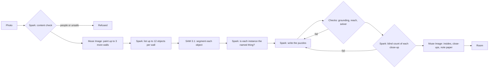

# Escape This Photo

Any photo of a room becomes a point-and-click escape room you play on your phone. Meta's **Muse Spark** writes the
puzzles, **SAM 3.1** measures the objects they rest on, and **Muse Image** paints the walls the photo doesn't show.
Code checks every room before anyone plays it: each count is confirmed against the picture, a solver proves there
is a way out with no dead ends, and nothing the way out needs is hidden under another object's tap area. Then a
blind playtester, an AI agent that has never seen the room, plays it from phone screenshots; only rooms it escapes
are in the gallery.

Built during the Meta Global AI Developer Hackathon (26 Oct – 4 Nov 2026), indie track, by Guillermo del Río, with
Claude Code.

Built during the hackathon: all of this code was written from 26 Oct 2026, after the kickoff.

## Play it

**https://escape-this-photo-51695996114.us-central1.run.app**

- The first room is Van Gogh's *The Bedroom*. It was **written by hand** as the reference room (its tap outlines
  were traced by SAM 3.1); every other room was built by the pipeline below.
- **The gallery** (`/rooms`) holds the rooms the pipeline built from openly licensed photos.
- **Your own photo:** making a new room spends Meta credit, so it needs an access code during judging; the code is in
  the submission text.

## How a room is made



A room that still fails after two rewrites is refused. Every step's cost is booked before the call is made.

| Step | Model | Where |
|---|---|---|
| Content check of every photo and painting | Muse Spark (`muse-spark-1.3`) | `server/screen.ts` `screen` |
| List objects per wall | Muse Spark | `server/pipeline.ts` `generateRoom` (`LIST_PROMPT`) |
| Segment each object: tap outlines, instance counts, sizes | SAM 3.1 | `server/sam.py`, called from `pipeline.ts` `segment` |
| Confirm each counted instance is the named thing | Muse Spark (vision) | `server/verify.ts` `checkInstances` |
| Write the puzzles, and rewrite them with the failed checks listed | Muse Spark | `server/pipeline.ts` `writeRoom` (`ROOM_PROMPT`) |
| Count each close-up the way a player would, from the clue words | Muse Spark (vision) | `server/verify.ts` `blindCounts` |
| Paint the unseen walls, opened containers, scenery close-ups, blank note paper | Muse Image (`muse-image-1.0`) | `server/pipeline.ts` `paintWalls`, `paintInteriors`, `paintDetails`, `paintNotes` |

## What is checked, and how

- **Grounding** (`src/engine/grounding.ts`): a count equals the instances SAM found *and* Spark confirmed, of a group
  of at least two; a number read off the photo is the whole number written there; a hidden thing is smaller than
  where it hides; every code is built from facts the room reveals; a counted thing's plain tap never states a number.
- **Reach** (`src/engine/reach.ts`): every object the way out needs keeps enough of its tap area uncovered on the
  phone; two objects SAM gave the same shape are merged.
- **Solver** (`src/engine/solver.ts`): a breadth-first search over the room's states proves the way out exists and
  that no sequence of moves leaves the player stuck.
- **Blind play-through** (`scripts/blind.mjs`, `scripts/blind-player.md`): a fresh Claude agent plays each gallery
  room on a phone-sized headless browser from screenshots only, with no answer key and at most 3 wrong codes per lock.
  Only rooms it escapes are in the gallery. The first rounds (28 Oct) are why the checks above exist: of the first
  three rooms, only one got out. One room's lock could never open (a plain description pre-empted it), one tool hint
  never showed, and a clue's number was never on screen. Each fault became an engine fix or a check with a test, and
  the solver now walks only what a tap would run.
  After the fixes, 10 of 14 gallery rooms escaped (2 needed a second try, one by a stronger model); the other 4
  were dropped. Each escaped room's "how this room was made" page shows its blind play.

## Run it

Needs Node 22 and [uv](https://docs.astral.sh/uv/) (for the SAM and image helpers).

```bash
npm install
npm test                      # engine, solver, grounding, spend caps and lockdown
npm run build && npm run server   # the game and the sample rooms on http://localhost:8080
```

The sample rooms in `samples/` are copied to `local/data/` on first start, so the gallery works without a key. To
build rooms, put `META_API_KEY=…` in `.env`, then open the spend switch for an hour and build one from a photo:

```bash
set -a; . ./.env; set +a; export META_SPEND_UNTIL=$(date -u -d '+1 hour' +%FT%TZ)
npx tsx server/try.ts path/to/room.jpg --paint-walls 3
```

`scripts/bench.sh` rebuilds the benchmark in [BENCHMARK.md](BENCHMARK.md) from photos in `local/bench/runs/`.

## Spend safety

Meta's API has no hard spending cap of its own, so `server/meta.ts` keeps a ledger that books each call's worst case
before making it and refuses past a daily cap and a fixed total. `server/lockdown.ts` adds two locks in front of every
paid call: a time switch that is off unless set (a fresh deploy can't spend), and access codes for making rooms. The
tests in `server/lockdown.test.ts` run the real server against a stub API and count zero requests with either lock shut.

## Licences

The code is MIT-licensed (`LICENSE`).

The gallery photos are from Wikimedia Commons under public domain, CC0, CC BY and CC BY-SA licences; each room shows
its photo's credit and licence. Walls painted by Muse Image from a CC BY-SA photo are shared under the same licence.
